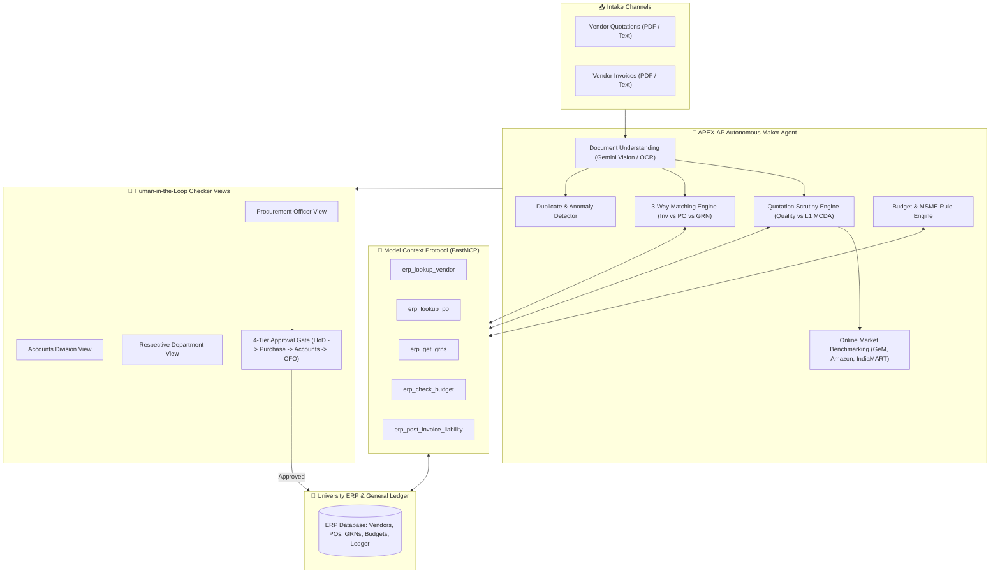

# 🏛️ APEX-AP: Autonomous Accounts Payable & Vendor Procurement Agent
### Problem Statement PS-09 | JK Lakshmipat University (JKLU), Jaipur

> **APEX-AP** is an enterprise-grade AI Agent designed as an **autonomous top layer** over existing University ERP systems. Built on the **Maker-Checker paradigm**, it acts as the **Maker**—automating quotation scrutiny, market price benchmarking, 3-way matching, duplicate detection, and accounting entries—while empowering human institutional officers as **Checkers** with role-specific views and multi-tier approval gates.
> 
> Styled strictly in **JK Lakshmipat University (JKLU)** brand identity (**Royal Blue `#0136A1`** and **Signature Orange `#F58220`**) with academic leadership and HoD rosters sourced from [jklu.edu.in](https://jklu.edu.in).

---

## 🌟 Key Capabilities & Highlights

1. **Two-Phase Lifecycle Support**:
   - **Phase 1: Pre-PO Procurement & Quotation Scrutiny (> ₹20,000 University Rule)**
     - Ingests multiple vendor quotations uploaded by Department HoDs.
     - Performs **Multi-Criteria Decision Analysis (MCDA)**: Organizations don't just pick the cheapest initial bid ($L_1$); the agent evaluates **Delivery Timeline**, **Warranty/Guarantee**, and **After-Sales Support SLA**.
     - Benchmarks item rates against online B2B marketplaces (**GeM Portal**, **Amazon Business**, **IndiaMART**).
     - Generates **Comparative Statements (CS)** and routes through a **4-Tier Approval Gate** (`HoD` $\rightarrow$ `Purchase Officer` $\rightarrow$ `Accounts Division` $\rightarrow$ `CFO`) to generate official POs.
   - **Phase 2: Post-PO Invoice Ingestion & Settlement**
     - Extracts unstructured PDF/Text invoices via Gemini Multimodal Vision / OCR.
     - Executes line-by-line **3-Way Matching** (Invoice vs Purchase Order vs Goods Receipt Note).
     - Detects exact and normalized duplicate submissions.
     - Enforces **MSME 45-day statutory payment caps** and captures early payment cash discounts.
     - Posts balanced **Double-Entry General Ledger journal vouchers** (`DR Expense`, `DR Input GST`, `CR Accounts Payable`).

2. **Integration via Model Context Protocol (MCP)**:
   - Sits on top of the university ERP as an intelligent agent layer communicating through standard **FastMCP** server tools (`erp_lookup_vendor`, `erp_lookup_po`, `erp_get_grns`, `erp_check_budget`, `erp_post_invoice_liability`, etc.).

3. **Enterprise Maker-Checker Views**:
   - **Procurement Officer View**: Line-item variance matrix (ordered vs received vs billed quantities and rates).
   - **Accounts Division View**: Tax breakdown (CGST/SGST/IGST), MSME due date, discount captures, draft journal entries.
   - **Respective Department View**: Departmental budget utilization (allocated vs committed vs remaining balance).

4. **JK Lakshmipat University Department & HoD Roster (jklu.edu.in)**:
   - Pre-configured with official JKLU leadership:
     1. **Institute of Engineering and Technology (`IET`)**: Dr. Tapas Kumar *(Dean, IET)* & Dr. Umesh Gupta *(Dean Academic Affairs)*
     2. **Institute of Management (`IM`)**: Dr. Sheetal Mundra *(Acting Head, Institute of Management)*
     3. **Institute of Design (`ID`)**: Prof. Rattan Gangadhar *(Dean, Institute of Design)*
     4. **Administration (`ADMIN`)**: Mr. Sonjay Dahiya *(DGM, Administration)* & CA K.K. Maheshwari *(Registrar)*
     5. **Hostels & Residential Life (`HOSTEL`)**: Dr. Devika Kataria *(Chief Warden, Hostels)*
     6. **Management Development Centre (`MDC`)**: Dr. Sheetal Mundra *(Chairperson, MDC & Executive Education)*
     7. **Security & Vigilance (`SEC`)**: Mr. Varun Rathi *(Senior Security Officer & Member Secretary)*
     8. **Marketing & Outreach (`MKT`)**: Mr. Aseem Bhatnagar *(Head, Brand & Marketing Outreach)*
     9. **Admissions and Outreach (`ADM`)**: Mr. Aseem Bhatnagar *(Head, Admissions and Outreach)*
     10. **Human Resources (`HR`)**: Mr. Prem Singh *(President Group HR & Panel Member)*
     11. **Finance & Accounts (`ACC`)**: CA. Arvind Kumar *(DGM, Finance & Accounts)* & CA K.K. Maheshwari *(CFO)*
     12. **Department of Chemistry & Sciences (`CHEM`)**: Dr. Devika Kataria *(Associate Professor & Head, Sciences)*
     13. **IT Infrastructure (`IT`)**: Dr. Umesh Gupta *(Dean Academic Affairs & IT Infrastructure)*

---

## 🏗️ System Architecture



---

## 🎯 Jury Evaluation Criteria Alignment

| Evaluation Criteria | Weight | How APEX-AP Fulfills It |
| :--- | :---: | :--- |
| **Agentic Capabilities & Workflow Automation** | **30 pts** | • Multi-step ReAct planning decomposing user input into parsing, benchmarking, verification, and audit trail.<br>• Reliable tool calling via Model Context Protocol (MCP) ($\ge 5$ tools).<br>• Graceful error recovery and reflection (flags anomalies, identifies missing GRNs, over-billing). |
| **Domain Accuracy & Problem Solving** | **25 pts** | • Strictly enforces Indian MSME 45-day payment statutory requirement & early payment discounts.<br>• Multi-factor quotation analysis prioritizing warranty and delivery over pure $L_1$ cheapness.<br>• Real-world online market price comparison against GeM, Amazon Business, and IndiaMART.<br>• Double-entry balanced accounting (`DR Expense`, `DR GST`, `CR AP`). |
| **System Architecture & Implementation** | **20 pts** | • Modular FastAPI backend, FastMCP server, SQLite persistent storage, and Tailwind CSS SPA.<br>• Zero-setup fallback mode for offline/sandbox testing, with native Gemini API key support.<br>• 25 automated unit tests passing in $< 2$ seconds. |
| **Safety, Privacy & Human Governance** | **15 pts** | • Zero autonomous state mutations without human approval.<br>• Maker-Checker separation: Agent generates proposals and dossiers, Checkers approve.<br>• Full audit logging of agent reasoning steps, tool payloads, and approver identity. |
| **Demonstration & UX Quality** | **10 pts** | • Interactive web dashboard (`http://localhost:8000`) with 1-click test presets.<br>• Dedicated CLI demo script (`demo.py`) walking through all Phase 1 and Phase 2 scenarios. |

---

## 📋 Procurement Governance: The > ₹20,000 Rule

For any institutional purchase exceeding **₹20,000**, university rules dictate strict scrutiny:
1. **HoD Initiation**: Respective department head uploads 2–3+ vendor bids.
2. **AI Quotation Scrutiny (Quality over Price)**:
   - Computes weighted score: **Commercial Price (40%)**, **Delivery Lead Time (20%)**, **Warranty Length (20%)**, **After-Sales SLA (20%)**.
   - Identifies if a cheaper bid ($L_1$) is inferior (e.g. 1-year carry-in warranty vs 3-year onsite support).
   - Queries online benchmark databases to ensure fair market pricing.
3. **Comparative Statement (CS)**: Prepared automatically for review by HoD and Purchase Officer.
4. **Institutional 4-Tier Approval Chain**:
   $$\text{Department HoD} \longrightarrow \text{Purchase Officer} \longrightarrow \text{Accounts Division} \longrightarrow \text{CFO}$$
5. **PO Generation**: Upon final CFO sanction, the ERP creates an official Purchase Order.

---

## 🚀 Quick Start Guide

### 1. Prerequisites
- Python 3.10+
- (Optional) `GEMINI_API_KEY` in environment for live Multimodal Vision understanding. If not provided, the agent automatically falls back to its deterministic regex OCR engine.

### 2. Installation
```powershell
# Clone or navigate to the repository
cd ap_agent

# Install dependencies
pip install fastapi uvicorn pytest httpx python-multipart
```

### 3. Run the Web Dashboard
```powershell
# Start the APEX-AP API & UI server
$env:PYTHONPATH="ap_agent"
python -m uvicorn ap_agent.api:app --host 127.0.0.1 --port 8080
```
Open your browser to:
- **Interactive Dashboard**: [http://127.0.0.1:8080](http://127.0.0.1:8080)
- **Interactive Swagger API Docs**: [http://127.0.0.1:8080/docs](http://127.0.0.1:8080/docs)

### 4. Run Automated Tests
```powershell
$env:PYTHONPATH="ap_agent"
pytest ap_agent/tests/ -v
```
*Expected: 25 tests pass in ~1.5s.*

### 5. Run the Full End-to-End Demo Script
```powershell
$env:PYTHONPATH="ap_agent"
python ap_agent/demo.py
```
This script executes:
- **Phase 1**: Quotation scrutiny for 10 Laptops (IET), MCDA scoring, online price checks, and 4-tier HoD $\rightarrow$ Purchase $\rightarrow$ Accounts $\rightarrow$ CFO approval with automatic PO issuance.
- **Phase 2**: Six diverse invoice scenarios:
  1. Clean partial delivery under ₹50,000 (Single-tier approval & double-entry posting)
  2. Unit price variance (+4.4%) flagged on exception hold
  3. Over-billing (cumulative billed > received goods) flagged on exception hold
  4. Normalized duplicate invoice detection (`inv 101` vs `INV-101`) auto-rejected
  5. Unordered line item (Laptop billed on Chemistry PO) auto-held
  6. High-value Server AMC exceeding department budget (Multi-tier DoA routing: HoD $\rightarrow$ Finance Controller $\rightarrow$ Registrar)

---

## 🖥️ API Reference & Endpoints

| Method | Endpoint | Description |
| :--- | :--- | :--- |
| `GET` | `/` | Serves responsive Tailwind Maker-Checker Dashboard. |
| `GET` | `/departments` | Returns list of all 12 university departments and budgets. |
| `GET` | `/market/search` | Benchmarks an item against GeM, Amazon Business, and IndiaMART. |
| `POST` | `/proposals/scrutinize` | Ingests 2-3+ quotations, runs MCDA scoring, and drafts comparative statement. |
| `GET` | `/proposals` | Lists all active procurement proposals and approval stages. |
| `GET` | `/proposals/{id}` | Retrieves full proposal dossier with comparative statement and approval history. |
| `POST` | `/proposals/{id}/decision`| Records approval/rejection from HoD, Purchase, Accounts, or CFO. |
| `POST` | `/invoices/intake` | Autonomous Maker invoice ingestion, 3-way matching, and dossier generation. |
| `POST` | `/invoices/{id}/decision` | Human Checker sign-off on invoice dossiers. |
| `GET` | `/liabilities` | Double-entry ERP accounts payable liabilities and journal entries. |
| `GET` | `/payments/schedule` | MSME payment schedule and early discount capture ledger. |
| `POST` | `/payments/{id}/execute` | Executes payout and updates ERP balance. |

---

## 🔒 Security & Data Governance
- **Zero Hallucination Policy**: Arithmetic, budget balances, and tax computations are calculated deterministically via Python and validated by MCP tools.
- **Synthetic Data**: Pre-seeded with realistic university data; no actual student or PII records are processed.
- **Audit Trails**: Every ReAct thought step, tool payload, and approval decision is immutably timestamped in the `audit_logs` table.

---

### Built with ❤️ for the AI Buildathon (PS-09)
